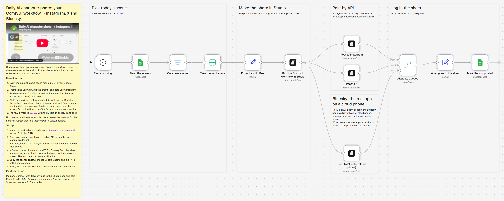

# Daily AI character photo: your ComfyUI workflow → Instagram, X and Bluesky

An n8n template. Every morning it takes the next scene from a Google Sheet, makes a photo with your own ComfyUI
workflow in Never Manual Studio, and posts it with Never Manual Slate: to Instagram and X by API, and to Bluesky
from the real app on a cloud phone. Each account writes its own caption in the character's voice.

Video walkthrough: https://youtu.be/uWoa948iCwE · Written guide: https://nevermanual.cloud/blog/run-comfyui-workflow-from-n8n

## Files

| File | What it is |
| --- | --- |
| `n8n-workflow.json` | The n8n workflow. In n8n: Workflows → Import from file. |
| `Krea 2 Kiki + realism.json` | The ComfyUI workflow it runs: Krea 2 Turbo, the Kiki character LoRA at 0.92 and a realism LoRA at 1.0. Import it in Studio; its models load by themselves. |
| `character-scenes.csv` | Five sample scenes with the sheet's columns. Or [copy the ready sheet](https://docs.google.com/spreadsheets/d/1F0Hlt7Qnklh0ceR3JaP79trpDQemQc7Rdoh841gIGdo/copy). |
| `workflow.png` | The picture above. |

## What you need

- n8n Cloud or self-hosted, with the verified community node `n8n-nodes-nevermanual` (tested 0.1.1 on n8n 2.47).
- A Never Manual account at [nevermanual.cloud](https://nevermanual.cloud) and an API key.
- Instagram and X connected in Slate. For Bluesky, a cloud phone (physical or virtual) with the Bluesky app and a
  photo-post preset.
- A Google account for the sheet.

The setup steps are in the overview note on the n8n canvas.

## Models

- Kiki character LoRA: [Civitai](https://civitai.com/models/2998942?modelVersionId=3401601)
- Krea2-realism-V2: [Hugging Face](https://huggingface.co/RudySen/Krea2-realism-V2)

Check each model's license before you use the photos commercially.
