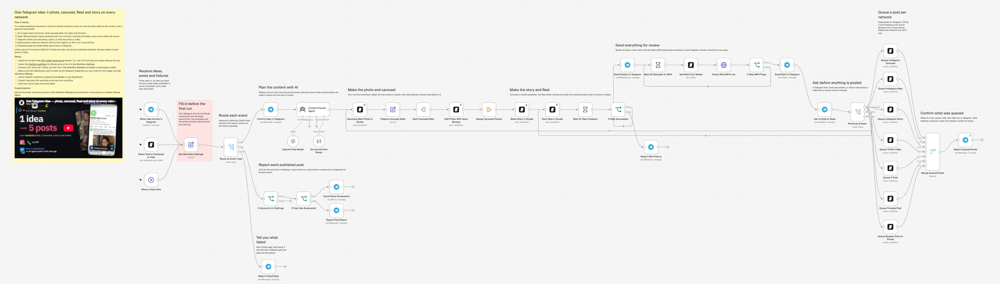

# One idea → photo, carousel, Reel and story on every network

An n8n template for [Never Manual](https://nevermanual.cloud): send one line to your Telegram bot, and the day's content is
made, approved by you in Telegram and posted everywhere.

**Video:** [a live run and the setup in under 4 minutes](https://youtu.be/oBbdvOPdc-0)

## What it does

1. **Telegram**: you send an idea, e.g. *Kiki finds a tiny ramen bar on a rainy evening*.
2. **AI Agent** (OpenAI) plans the day in one structured answer: the photo's scene, three carousel edits, the video's
   motion and the story's words.
3. **Never Manual Studio** makes it all on GPUs:
   - the main photo with **your own ComfyUI workflow** (here Krea 2 with a character LoRA);
   - three edits of it for a carousel (Nano Banana edit);
   - a 9:16 story with your words on it (built-in pipeline *Story from a photo*);
   - a Reel with sound and an AI-written hook on top, plus its cover (built-in pipeline *Reel from a photo*: LTX-2.3
     image-to-video → 9:16 → four frames → a hook from them → text on the video → cover). Studio calls the workflow
     back when the Reel is done; nothing is polled.
4. **Telegram** shows you the pictures and the Reel: *Post everywhere*, *New photo* or *New video* (with a note on what
   to change).
5. **Never Manual Slate** posts: Instagram carousel, Reel and story, TikTok, X and Threads by their official APIs, and
   Bluesky in the real app on a cloud phone, where an AI agent first replies to new comments under the last post. Each
   account writes its own caption in its own voice.
6. Every post that goes out comes back to Telegram; the phone's with a screenshot of its last screen.

If a Studio step fails twice, the Error Trigger in the same workflow says where and why in Telegram.

## Files

| File | What it is |
| --- | --- |
| `n8n-workflow.json` | The workflow to import into n8n |
| `Krea 2 Kiki + realism.json` | The ComfyUI workflow for the main photo, to import into Studio |
| `workflow.png` | The canvas |

## Setup

1. In n8n, install the verified community node **`n8n-nodes-nevermanual`** (tested with 0.1.1 on n8n 2.46–2.47).
2. Sign up at [nevermanual.cloud](https://nevermanual.cloud); make an API key in Accounts → API keys and add it as the
   *Never Manual API* credential.
3. In Studio, import `Krea 2 Kiki + realism.json` (or use any workflow of yours that takes a `Prompt`) and put its ID in
   **Set Workflow Settings → photo_workflow** (it looks like `user/krea-2-kiki-realism-xxxxxx`).
4. In Slate, connect your accounts: Instagram, TikTok, X, Threads by API; Bluesky on a cloud phone with a posting preset.
   Give each account an Autofill voice for captions. Put the account IDs in **Set Workflow Settings**; delete the Queue
   nodes of networks you don't use and give **Merge Queued Posts** the same number of inputs as the Queue nodes left.
5. Make a bot with [@BotFather](https://t.me/BotFather), add its token as the *Telegram* credential, and put your chat ID
   in the trigger's *Restrict to Chat IDs* and in **Set Workflow Settings → telegram_chat_id** (both hold the
   placeholder `YOUR_TELEGRAM_CHAT_ID` until then, so the bot answers no one else).
6. Add an OpenAI credential to **OpenAI Chat Model** (n8n Cloud's free OpenAI credits work too), or swap it for OpenRouter Chat Model.
7. Publish the workflow, then Workflow settings → *Error workflow* → pick this workflow (n8n lists it once it is
   published), so failures reach Telegram.
8. Send your bot an idea.

## Cost and time

One idea in our live run on n8n Cloud (Nov 19, 2026): about **$0.29** in Studio — main photo $0.015, three edits
$0.078, the Reel's 5-second video $0.17–0.18, the hook $0.001, the story $0 — and about **14 minutes** from the message
to the look in Telegram, most of it the video (a GPU card starting and the MP4 being made). Posting is part of your
Slate plan; the model that plans the day costs a fraction of a cent.

## Customization

- **Set Workflow Settings**: the character, how the photo prompt starts and ends, the video's length, the accounts.
- **Content Planner Agent**: the agent's instructions — the formats, the tone, the language.
- Swap the main photo's workflow for any of yours, or the carousel's model for another one Studio offers.
